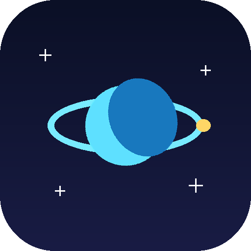
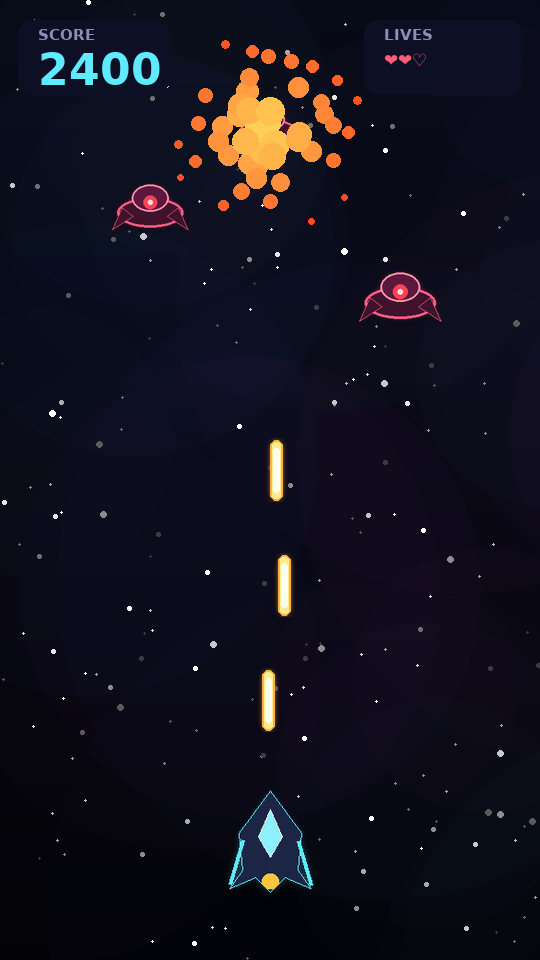
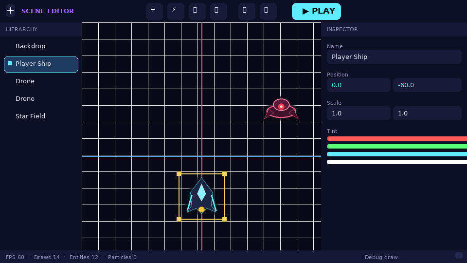

<p align="center">
  
</p>

<h1 align="center">NEBULA ENGINE</h1>

<p align="center">
  A professional 2D game engine <b>and</b> an on-device game editor for Android —<br/>
  built from scratch in <b>Kotlin</b> and <b>C++17</b> with <b>OpenGL ES 3.0</b> rendering.
</p>

<p align="center">
  <code>Kotlin</code> · <code>C++17</code> · <code>OpenGL ES 3.0</code> · <code>Android NDK</code> · <code>Sparse-set ECS</code> · <code>GLES batcher</code>
</p>

---

**Nebula Engine** is not a wrapper around someone else's engine. Every layer — math, ECS,
physics, particles, sprite animation, scene serialization, renderer, JNI bridge and the editor
itself — is implemented in this repository. It ships three things in one app:

| Module | What it is |
|---|---|
| **Nebula Run** | A complete flagship demo game (`engine/game/nebula_run.cpp`) driven entirely by the engine's public C++ API |
| **Scene Editor** | A professional on-device 2D editor: hierarchy, live GLES viewport, inspector (transform / tint / z-order / physics), pick-and-drag gizmos, pinch-zoom, one-tap **Play** |
| **The Engine** | The reusable, dependency-free C++17 core (`app/src/main/cpp/engine/`) |

## ✨ Feature tour

### Engine core (C++17, zero third-party dependencies)
- **Sparse-set ECS registry** — dense component pools, O(1) lookup, cache-friendly iteration, type-erased destruction (`engine/ecs/registry.hpp`)
- **2D physics** — semi-implicit Euler integration, spatial-hash broadphase, impulse solver with restitution/friction + Baumgarte positional correction, triggers, AABB/circle narrowphase, raycasts (`engine/physics/physics_world.cpp`)
- **Sprite batching renderer** — one dynamic VBO, texture-sorted batching, typical scenes run in single-digit draw calls, straight-alpha blending, CPU-flipped texture upload
- **Orthographic camera** — zoom, pan, screen↔world conversion, camera shake support
- **Scene system** — scenes serialize to portable, human-readable `.nebula.json` (name, camera, entities, transforms, sprites, rigidbodies, colliders, tints, tags)
- **Particle system** — fixed-capacity CPU pool, bursts (explosions) and sprays (thrusters/muzzle), per-particle gravity/drag/angular velocity, rendered as soft radial-gradient dots
- **Sprite sheet animator** — frame timing, columns layout, loop/once modes
- **Hand-rolled JSON** — parser + serializer used for scene files (`engine/json/`)
- **Multi-touch input state** — up to 10 pointers, screen↔world mapping, editor-grade gestures
- **Procedural built-in textures** — 1×1 white quad and soft dot particle are generated at runtime, no assets required

### Scene editor (runs on the phone/tablet)
- **Hierarchy panel** — tap to select, live entity list with tags
- **Live viewport** — GLES-rendered world with adaptive grid, origin axes, amber selection gizmo with corner handles
- **Gestures** — tap to pick (AABB hit-test), drag to move entities, drag empty space to pan, pinch to zoom **anchored at the pinch focus**, two-finger drag to pan
- **Inspector** — name, tag, position, scale, rotation, sprite size, z-order, RGBA tint (live seekbars), physics: add dynamic/static body + box collider, remove physics
- **Add menu** — spawn ship / enemy / bullet / star / backdrop sprites at the camera center
- **Save / Load** — scenes persist as `scene.nebula.json` in app-private storage; auto-saved on pause
- **Play** — serializes the current scene and launches the runtime in *sandbox playtest* mode: physics and particles go live instantly (gravity, bounces, collisions)
- **Debug draw** — toggles collider wireframes
- **Status bar** — FPS · draw calls · entity count · particle count, updated at 2 Hz

### Nebula Run (flagship demo)
- Steer with your finger (the ship banks into the turn), weapons auto-fire
- Enemy drones dive with ramping difficulty, floating starfield with parallax drift
- Trigger-based collisions → particle explosions, camera shake, procedural SFX (laser / explosion / hit / game-over) synthesized as WAVs
- Score, 3 lives, persistent best score, game-over flow with retry

## 🏗 Repository layout

```
├── app/src/main/cpp/           # ══ C++17 engine core (NDK) ══
│   ├── engine/
│   │   ├── math/               # Vec2, Mat4, Rect/AABB, Color, Random
│   │   ├── json/               # dependency-free JSON parser/serializer
│   │   ├── ecs/                # sparse-set registry + built-in components
│   │   ├── physics/            # spatial hash broadphase + impulse solver + raycasts
│   │   ├── particles/          # CPU particle pool
│   │   ├── animation/          # sprite sheet animator
│   │   ├── input/              # multi-touch input state
│   │   ├── scene/              # Scene = Registry + Camera + JSON (de)serialization
│   │   ├── render/             # camera2d, IRenderer, GLES3 batcher
│   │   ├── game/               # Nebula Run demo game logic
│   │   └── nebula_engine.*     # engine facade (portable, GL-agnostic API)
│   ├── jni/nebula_jni.cpp      # JNI bridge (serialized via one mutex)
│   └── CMakeLists.txt          # NDK build → libnebula2d.so
│
├── app/src/main/kotlin/com/nebula/engine/
│   ├── NebulaNative.kt         # external declarations (1:1 with JNI exports)
│   ├── EngineView.kt           # GLSurfaceView: GL thread, texture registry, touch
│   ├── MainActivity.kt         # launcher hub (game / editor)
│   ├── game/GameActivity.kt    # HUD, sounds, game-over flow, sandbox playtest entry
│   ├── editor/EditorActivity.kt# on-device editor (viewport gestures, inspector)
│   └── audio/SoundManager.kt   # SoundPool SFX
│
├── app/src/main/assets/        # procedural sprites + synthesized SFX (see scripts/)
├── tests/engine_tests.cpp      # 23 host-run unit/integration tests
├── scripts/
│   ├── run_native_tests.sh     # build & run the C++ test suite (no device needed)
│   └── generate_assets.py      # regenerate all textures/SFX/icons procedurally
└── docs/ARCHITECTURE.md        # deep-dive into engine internals
```

## 🚀 Build & run (Android)

**Requirements:** Android Studio Hedgehog+ · JDK 17 · Android SDK 34 · NDK 25+ · CMake 3.22.1

```bash
# 1) Open the project in Android Studio (File → Open → this repo)
#    Studio installs the NDK/CMake automatically if missing.
# 2) Or from the command line with a configured SDK:
./gradlew :app:assembleDebug          # → app/build/outputs/apk/debug/app-debug.apk
./gradlew :app:installDebug           # installs on a connected device/emulator
```

> The Gradle wrapper jar is not vendored (binary artifact). Android Studio
> regenerates it on first open, or run `gradle wrapper --gradle-version 8.4`
> with a local Gradle 8.4+.

**Verified here on CI:** all engine C++ compiles with `-Wall -Wextra` and the full
test suite passes on a host toolchain. The Android APK build itself requires the
Android SDK (not available in this authoring sandbox), so treat the Kotlin/Gradle
layer as "build with Studio" — the native core is machine-checked.

## 🧪 Run the engine tests (host, no device/emulator needed)

```bash
./scripts/run_native_tests.sh
```

```
=== Nebula Engine — native test suite ===
  [PASS] physics_box_rests_on_static_floor
  [PASS] physics_trigger_fires_enter_exit_events
  [PASS] scene_serialize_deserialize_roundtrip
  ... 23 tests run, 0 failed
```

## 📸 Previews (mock frames composed from the in-repo assets)

<p align="center">
  
  &nbsp;&nbsp;
  
</p>

Left: **Nebula Run** in action — SCORE/LIVES HUD, finger-steered ship, auto-fired
energy bolts, trigger-collision explosions (C++ particle system). Right: the
**on-device Scene Editor** — hierarchy, GLES viewport with adaptive grid & origin
axes, amber selection gizmo with corner handles, full inspector and the status bar.
Both are static mockups built with the same sprites/colors the engine renders.

## 🎮 Controls

**Nebula Run** — drag anywhere to steer; weapons fire automatically; avoid or destroy the drones.
**Editor viewport** — tap = select · drag entity = move · drag empty space = pan · pinch = zoom at focus · two-finger drag = pan.

## 🧩 Scene file format (`.nebula.json`)

```json
{
  "format": "nebula-scene/1",
  "name": "My Level",
  "camera": { "x": 0, "y": 0, "zoom": 1.42 },
  "entities": [
    {
      "name": "Player", "tag": "player",
      "transform": { "x": 0, "y": -140, "rotation": 0, "scaleX": 1, "scaleY": 1 },
      "sprite": { "texture": "ship", "sizeW": 118, "sizeH": 118,
                  "tint": [1, 1, 1, 1], "zOrder": 10,
                  "srcX": 0, "srcY": 0, "srcW": -1, "srcH": -1,
                  "flipX": false, "flipY": false },
      "rigidbody": { "velocityX": 0, "velocityY": 0, "gravityScale": 0,
                     "restitution": 0.25, "friction": 0.45, "density": 1,
                     "mass": 1, "isStatic": true },
      "circleCollider": { "radius": 34, "offsetX": 0, "offsetY": 0,
                          "isTrigger": true, "restitution": -1, "friction": -1 }
    }
  ]
}
```

Textures are stored by **logical name**, never by GL id — scene files are portable across devices and builds.

## 🗺 Roadmap

- [ ] Tiled-map importer (.tmx) and tile layers
- [ ] Audio engine: music crossfade + positional audio in C++ (AAudio)
- [ ] Vulkan backend behind the `IRenderer` seam
- [ ] Prefab system & nested scenes
- [ ] Undo/redo stack in the editor (command pattern)
- [ ] Export-to-APK from within the editor (template project + Gradle)

## 📄 License & authorship

All code and generated artwork/audio in this repository were authored for this project
(assets are produced by `scripts/generate_assets.py`). Choose your license before publishing.
